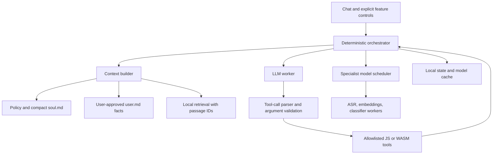

# Picobot: browser-local assistant research and development plan

Research date: 14 October 2026. This is a researched proposal, not a measured benchmark. The workspace was empty at the start of this investigation. Confirmed direction: laptops first, phones later; train a new model from scratch with ternary {-1, 0, +1} weights; rented training compute is acceptable. Training is not constrained to the user's laptop. All deployed inference and personal memory stay on the client. Existing checkpoints below are comparison baselines and runtime probes.

## Recommendation

Build a browser-local assistant with a natively trained ternary language model, deterministic tools, local retrieval, and optional specialist models. Begin with a browser benchmark harness and a small from-scratch training pilot. Use a narrow useful workflow: answer questions about an imported document, cite its passages, calculate accurately, and remember user-approved preferences.

Maintain separate tracks:

1. Product track: find the smallest model that meets task quality, responsiveness, download, and reliability goals.
2. Systems track: measure the feasible envelope of model size, quantization, context length, browser, hardware, and auxiliary workloads.
3. Training track: train ternary models from random initialization, validate learning and instruction following, then export packed weights with numerically verified browser kernels.

Do not make maximum parameter count the product objective. Do not assume adding tools gives a tiny model the reasoning or instruction-following ability of a much larger one. Tools improve the system only when routing, argument extraction, retrieval, and interpretation work.

## Ternary model direction: what 1.58 bits buys

The proposal matches [BitNet b1.58](https://arxiv.org/abs/2402.17764): use ternary weights in BitLinear layers and train with that constraint. It is a credible research direction for browser deployment. It does not establish that every model component is ternary or that any pretrained model can be rounded to these values without losing quality.

`log2(3) = 1.58496` describes the information needed per ternary symbol under a uniform-symbol coding model. Actual fixed storage needs a packing scheme:

- Two bits per weight: four weights per byte; simple addressing and unpacking.
- Five base-3 digits per byte: 1.6 bits per weight, since `3^5 = 243`; denser packing with more involved extraction.
- Entropy coding: may compress downloads further, especially with nonuniform symbol frequencies, but does not automatically provide efficient random access during GPU inference.

Use 2-bit packing as the first runtime baseline. Evaluate 1.6-bit packing later rather than assuming it is faster. The original BitNet paper used 2-bit kernels in its memory/latency evaluation and retained full-precision embeddings. The [2B4T report](https://arxiv.org/html/2504.12285v2) likewise describes specialized packed-weight kernels. Do not equate the model family name with exact end-to-end bits per parameter.

| Parameters, if all packed uniformly | Ideal 1.585-bit payload, decimal MB | Practical 2-bit payload, decimal MB | 4-bit payload, decimal MB |
| --- | ---: | ---: | ---: |
| 150M | 29.7 | 37.5 | 75 |
| 350M | 69.3 | 87.5 | 175 |
| 1B | 198.1 | 250 | 500 |
| 2B | 396.2 | 500 | 1,000 |
| 3B | 594.4 | 750 | 1,500 |
| 8B | 1,585.0 | 2,000 | 4,000 |

These calculations exclude scales, embeddings, output heads, metadata, KV cache, activations, workspace, and loading copies. At the same budget for packed linear weights, 2-bit storage permits approximately twice the parameters of 4-bit storage; near-1.585-bit storage permits about 2.52 times. This is neither an equal-quality guarantee nor the scaling factor for total runtime memory.

### Browser execution is a separate engineering problem

WebGPU can implement packed ternary operations using custom WGSL kernels. A low-bit file alone is insufficient: unpacking the entire model into FP16/FP32 tensors would lose most resident-weight savings. Keep packed weights in GPU buffers and unpack only the values needed during computation. Compare decode and prefill separately; the best implementation may differ.

The community [0xBitNet project](https://github.com/m96-chan/0xBitNet) provides a current browser/WebGPU candidate. Its [architecture documentation](https://raw.githubusercontent.com/m96-chan/0xBitNet/main/docs/architecture.md) describes I2_S 2-bit packed weights, custom ternary kernels, FP16 embeddings, activation quantization, and sharding. It must be audited and benchmarked before selecting it. Existence of a working demo is not proof of stable cross-device performance. Microsoft's [bitnet.cpp](https://github.com/microsoft/BitNet) is an official native CPU inference reference; native ARM/x86 results cannot be assumed for browser WASM or WebGPU.

Before a large training run, verify a tiny random model through the entire path: training forward pass → checkpoint → ternary export → packed loader → browser logits. Check scales, rounding, activation quantization, normalization, positions, attention state, tensor layout, and tokenizer/template. Compare logits within a documented tolerance and repeated autoregressive steps against a trusted reference. Avoid selecting an architecture that the chosen browser engine cannot execute.

### From-scratch training with rented compute

Native ternary training typically retains real-valued latent weights, gradients, and optimizer state. Forward passes use quantized weights; surrogate/straight-through gradients allow latent weights to update. The deployed representation can be tiny while the training representation remains much larger. Packed inference kernels do not automatically make backpropagation cheaper. Microsoft's [model release](https://huggingface.co/microsoft/bitnet-b1.58-2B-4T) distinguishes packed inference weights from BF16 master weights.

Recommended starting experiment: a 150–350M dense decoder, short context initially, BitLinear projections, and a compact vocabulary chosen for the target languages. Consider grouped-query attention to reduce KV cache, and test tied embeddings/output heads where compatible. These choices are hypotheses to evaluate, not a claim that one recipe is optimal. Keep the first architecture simple and aligned with the export/runtime path.

Count full-precision tensors carefully. A 32,000-token vocabulary with width 768 contains 24.6M embedding weights, taking about 49.2 MB at FP16 before any separate output head. In a small ternary model, that can outweigh many packed decoder weights. A huge vocabulary can defeat the download-size objective even when the transformer layers are ternary.

Proposed training stages:

1. Correctness pilot: tiny model and small text subset; prove decreasing held-out loss, stable gradients, checkpoint resume, packing correctness, and browser parity.
2. 150–350M pilot: train approximately 0.1–1B tokens, depending on a measured compute budget. This verifies throughput and learning; it is not a promise of useful general chat.
3. Controlled comparison: match a ternary model and conventional model for architecture, data, tokenizer, and training tokens. Also report a deployment-budget comparison against 4-bit baselines. These answer different questions.
4. Longer training: increase to several or tens of billions of tokens only if validation/task progress supports the investment. Deduplicate and filter data, record licensing/provenance, exclude evaluation overlap, and reserve distinct held-out sets. Do not blindly repeat a small corpus to reach a token count.
5. Instruction/tool stage: SFT for concise answers, tool routing/arguments, citations, ambiguity handling, and preference memory. Optional teacher-generated supervision is post-training assistance, not reuse of teacher weights; disclose it in the paper if used.
6. Scale decision: consider 0.7–2B parameters if the browser tests show headroom and the training budget can support enough data. Larger parameter count with inadequate training is not necessarily a better assistant.

Use `training cost ≈ 6 × parameters × training tokens` FLOPs only as a rough dense-transformer planning estimate, not a ternary-runtime measurement. For illustration, 300M parameters over 10B tokens are approximately `1.8e19` FLOPs; 1B over 100B tokens are approximately `6e20` FLOPs. Real training adds or changes work due to attention, quantization, optimizer, evaluations, and implementation. Budget from sustained measured tokens/second and an actual GPU quote, not peak advertised FLOPs. No compute rental or paid run is authorized by this document alone.

The published BitNet 2B4T checkpoint was trained on 4T tokens. It establishes the feasibility of capable ternary models, not that a small affordable run will reproduce its quality. Scope the initial home-trained assistant around useful grounded tasks rather than broad knowledge.

Training frameworks to evaluate: [nanochat](https://github.com/karpathy/nanochat) as an end-to-end training reference, and [Hugging Face's SmolLM pretraining recipes](https://github.com/huggingface/smollm/blob/main/text/pretraining/README.md) for small-model data/training structure. Neither is automatically a turnkey ternary-to-browser pipeline. Pick the framework after verifying the required quantization-aware training and export work.

## What fits in a browser?

There is no universal maximum parameter count. The model must fit the runtime's representation and buffer layout, device memory, browser/process budget, and acceptable loading and response times. Fitting once is weaker than running reliably over a long session.

The approximate dense weight payload is:

`weight bytes = parameter count × stored bits per parameter / 8`

| Parameters | Ideal packed 4-bit payload, decimal MB |
| --- | ---: |
| 135M | 67.5 |
| 360M | 180 |
| 600M | 300 |
| 1B | 500 |
| 3B | 1,500 |
| 8B | 4,000 |
| 20B | 10,000 |

These are arithmetic lower bounds for uniformly packed weights, not expected downloads or runtime memory. Quantization scales, unquantized tensors, tokenizer files, runtime code, loading copies, activations, workspaces, and attention state add overhead. Some implementations reserve state for the configured maximum context.

For a conventional attention decoder, an approximate KV cache formula is:

`KV bytes = 2 × layers × tokens × KV heads × head dimension × bytes per KV element × batch size`

Example: 24 layers, 4 KV heads, head dimension 64, 4,096 tokens, FP16 state, batch size 1 require about 96 MiB for KV state alone. This formula does not describe recurrent/hybrid state or every runtime's allocation strategy.

The current [WebLLM model catalogue](https://raw.githubusercontent.com/mlc-ai/web-llm/main/src/config.ts) lists the following `vram_required_MB` values for q4f16 configurations with context window 4,096:

| Model | Catalogue memory estimate, MB |
| --- | ---: |
| SmolLM2-360M-Instruct | 376.06 |
| Qwen3-0.6B | 1,403.34 |
| Qwen3-1.7B | 2,036.66 |
| Qwen3-4B | 3,431.59 |
| Qwen3-8B | 5,695.78 |

These are upstream configuration estimates, not total tab/process memory or measurements made for Picobot. They demonstrate why model architecture and runtime matter alongside parameter count. The same catalogue has FP16/FP32 entries for SmolLM2-135M; do not assume every model has every desired quantization precompiled.

Use these initial test bands as hypotheses, not compatibility promises:

- Constrained phones/devices: 135–360M; short contexts; evaluate CPU fallback separately.
- Ordinary laptops: 360–800M initial default candidates; 1–3B optional quality upgrades after measurement.
- Strong desktops/laptops: 4–8B stress tests, then larger models if the selected engine can load them.

Larger-than-8B browser inference is already demonstrated: the [Transformers.js releases](https://github.com/huggingface/transformers.js/releases) report GPT-OSS 20B q4f16 at approximately 60 tokens/s on an M4 Pro Max. That is a vendor-reported result on specific hardware, not an ordinary-device target or a universal ceiling. For MoE, active parameters affect compute but total resident weights still affect memory.

### Constraints to measure separately

- GPU buffer limits are individual allocation/binding limits, not the total available VRAM. Inspect adapter limits and request supported higher limits when the engine requires them. The [WebGPU specification](https://www.w3.org/TR/webgpu/) defines baseline limits; those values do not cap a whole model to one buffer.
- The [ONNX Runtime Web large-model guide](https://onnxruntime.ai/docs/tutorials/web/large-models.html) documents its current 4 GB WASM memory constraint and separate large ArrayBuffer/protobuf issues. This is an engine/loading-path constraint, not a universal 4 GB limit on all browser inference. Check the exact version/backend selected, especially when comparing newer Transformers.js releases.
- GPU memory availability cannot be inferred reliably from `navigator.deviceMemory`, storage quota, or buffer limits. Probe conservatively; those signals are not free-memory meters.
- Browser caches can be evicted. Use `navigator.storage.estimate()` and request persistence, but offer export and re-download recovery. See [browser storage quotas and eviction](https://developer.mozilla.org/en-US/docs/Web/API/Storage_API/Storage_quotas_and_eviction_criteria).
- Include model download, cold shader compilation, warm initialization, thermal effects, GPU device loss, other tabs, and sustained use in testing.

## Model shortlist

| Candidate | Role | Decision condition |
| --- | --- | --- |
| SmolLM2-135M-Instruct | Minimum-size baseline | Test constrained instruction following; do not depend on autonomous tool use |
| SmolLM2-360M-Instruct | Simple small browser baseline | Compare quality with newer models under equal budgets |
| LFM2.5-350M | Tool-routing/extraction candidate | Verify browser export, operator support, quantization, chat template, and license suitability |
| Qwen3-0.6B | Established browser comparison | Measure bounded non-thinking mode against other small models |
| Qwen3.5-0.8B | Newer small-model candidate | Validate the exact browser build and text/vision scope; measure state and memory costs |
| Qwen3-1.7B or a compatible 1–3B instruct model | Quality upper baseline | Keep optional until download/memory and task-quality improvements justify it |

The [SmolLM2 card](https://huggingface.co/HuggingFaceTB/SmolLM2-135M-Instruct) provides browser usage and identifies dedicated function-calling support for its 1.7B variant. That does not establish robust tool use for the smaller variants. Its 135M pretraining used 2 trillion tokens: training a good tiny model from scratch is still a substantial data and compute project.

The [LFM2.5-350M card](https://huggingface.co/LiquidAI/LFM2.5-350M) recommends extraction, structured outputs, and tool use while discouraging knowledge-intensive tasks and programming. It uses the LFM license. Treat these as author claims to test. Default tool-call syntax must be parsed as data, never executed as model-generated Python.

[Qwen3-0.6B](https://huggingface.co/Qwen/Qwen3-0.6B) supports thinking and non-thinking modes. Use the appropriate chat template and begin with bounded non-thinking outputs for interactive workflows. [Qwen3.5-0.8B](https://huggingface.co/Qwen/Qwen3.5-0.8B) is an additional current candidate, not a guaranteed winner before testing.

Quantization and pruning are different: quantization reduces precision/storage; pruning reduces selected weights or structures; distillation trains a student; LoRA/SFT adapts behavior. Start with supported 4-bit and 8-bit exports, then task-focused fine-tuning if evaluation exposes a consistent failure. Keep an unquantized or higher-precision reference to measure quality loss. A quantized sparse model does not automatically yield faster execution without compatible sparse kernels.

## Runtime direction

Use WebLLM for conventional LLM baselines and Transformers.js for specialist tasks. Evaluate an existing ternary browser engine separately for the planned custom model; ordinary q4 support does not establish packed ternary support. Put engines behind small adapters so the benchmark can compare without rewriting the app. Prefer auditing/extending a suitable existing ternary engine before building one from scratch.

[WebLLM](https://webllm.mlc.ai/) provides a browser LLM API, structured-output capabilities, and MLC model integration. Its [advanced usage documentation](https://webllm.mlc.ai/docs/user/advanced_usage.html) supports worker-based execution. Use a dedicated worker for the active engine, cancellation, progress, streaming, and lifecycle events. WebGPU support must be detected on the actual browser/device.

[Transformers.js WebGPU documentation](https://huggingface.co/docs/transformers.js/guides/webgpu) demonstrates embeddings, Whisper tiny speech recognition, and MobileNet classification. Its [dtype guide](https://huggingface.co/docs/transformers.js/guides/dtypes) explains available quantizations and per-module precision. Validate exact model exports and installed versions; a checkpoint existing on Hugging Face does not guarantee a usable browser export.

Only compare speed across engines with matched device, model revision, quantization, context, prompt/template, generation settings, and warming. When matching is impossible, report the differing configurations rather than attributing the result purely to the engine.

## Application architecture

### Orchestrator and tools

Give the model a small set of relevant tools for each request, not an ever-growing catalogue. Prefer explicit controls or deterministic routing for obvious actions. Allow the model to propose a tool call, then validate its tool name, arguments, ranges, file access, and resource budget. Schema-valid JSON establishes format, not semantic correctness.

Initial tools: arithmetic, unit conversion, text search, passage retrieval, and simple CSV/JSON conversion. Calculate with a parser/library; never `eval` model output. Return exact tool results directly where useful so the model cannot accidentally rewrite a number or corrupt a converted file. Limit tool steps, retries, output tokens, and wall-clock duration.

### Context, soul.md, and user.md

- `soul.md`: short style and behavior preferences, compiled into the active prompt. It is not training and cannot create missing capabilities.
- `user.md`: explicit, editable, deletable user facts and preferences. Save proposed facts only through an application-controlled memory action, with provenance and a way to correct them.
- Document store: imported files, extracted text, chunk IDs, source metadata, and a local index.
- Working context: recent turns, selected facts, relevant passages, tool results, and an output-token reserve.

A starting 2,048-token context budget might allocate 250 to policy/style, 100 to selected user facts, 450 to the current question and recent turns, 800 to evidence, and 448 to output. This is a tunable design example. Count actual tokens and handle overflow. Begin with lexical retrieval, then test whether a small embedding model improves task success enough to justify its cost. Do not paste whole memory files or entire conversations into every request.

Store user data in IndexedDB/OPFS as appropriate and let the inference engine use its supported model cache. Keep data and model lifecycle controls visible. PWA app-shell caching and model caching are separate; offline operation needs both. External text is evidence, not application instruction: it cannot alter tools, memory rules, or access controls.

### Multiple small models

Install optional feature packs and load them on demand. Keep one main LLM resident initially. Serialize heavy GPU tasks; add measured concurrency only if it improves the overall user experience. Separate workers alone do not isolate GPU memory or prevent contention.

| Feature | Starting approach |
| --- | --- |
| Calculators/unit conversions | Deterministic JavaScript |
| CSV/JSON/text conversion | Deterministic JavaScript with format validation |
| Image resize/format conversion | Browser image APIs for supported formats |
| Image classification | Small MobileNet-class model |
| Document search | Lexical index, optional compact embedding model |
| Speech input | Local Whisper tiny or verified local browser recognition |
| Speech output | Verified local installed voice, optional small local TTS model |
| Complex Office/media conversion | Separate WASM feasibility tests, resource limits, and format-specific scope |

Do not imply universal file conversion or perfect format fidelity. Some formats need expensive libraries or do not round-trip cleanly. Browser speech recognition is not automatically local: [Web Speech documentation](https://developer.mozilla.org/en-US/docs/Web/API/Web_Speech_API/Using_the_Web_Speech_API) describes server processing and the explicit local path. Verify local voices similarly and test with the network disabled.

## Web access and the local-only promise

Separate local inference, offline availability, and network-assisted retrieval in the product. A static host/CDN is still needed for initial app/model distribution, but no inference server is required. Online searches necessarily expose at least requested URLs or queries to some remote service; keep personal context out of those requests unless the user chooses otherwise.

[CORS](https://developer.mozilla.org/en-US/docs/Web/HTTP/Guides/CORS) prevents a normal webpage from reading arbitrary cross-origin responses. `no-cors` does not expose readable page contents. Choose among:

1. Initial pure-web mode: pasted text, imported files/HTML, same-origin content, and CORS-enabled APIs.
2. Optional browser extension: extract an explicitly selected page and use background/extension requests with appropriate [host permissions](https://developer.chrome.com/docs/extensions/develop/concepts/network-requests). This expands access without adding an inference backend but adds installation and permission costs.
3. Optional retrieval proxy/search service: inference stays local; retrieval is an online service and should be labeled accordingly. Do not depend on public CORS bypass proxies or embed privileged API keys in shipped JavaScript.

An extension is preferable if broad page access and no application backend are firm requirements. A PWA is preferable if installation-free access is the first priority. Neither grants universal access to blocked, authenticated, or dynamically rendered pages.

## First development milestones

### A. Feasibility harness

Implement a minimal page with model selection, backend selection, context controls, run/export buttons, progress, cancellation, and device-loss recovery. Capture exact versions and configuration. Test at least one ordinary laptop and one constrained device before committing to a default.

First candidates: 135M and 360M baselines, a 350M tool-use candidate when exported, Qwen3-0.6B, Qwen3.5-0.8B, and one 1–3B quality baseline. Start at 1K/2K/4K contexts; compare available q4/q8 configurations. Expand size only on devices that pass smaller tests with headroom. Do not repeatedly crash a user's browser to estimate its maximum.

### B. One useful assistant workflow

Implement streamed chat, one-document import, retrieval with passage references, calculator, editable persona, explicit preference memory, and cache/offline controls. Evaluate before adding voice or vision.

### C. From-scratch ternary training and post-training

Follow the staged ternary training plan above using rented compute. Train from random initialization; existing models remain evaluation baselines. After pretraining, curate task-specific SFT examples with correct tool calls, ambiguous inputs, abstentions, citations, and multi-turn corrections. Hold out paraphrases, tools, document topics, and argument distributions where possible. Export packed weights for client inference; measure gains and regressions after conversion.

### D. Specialist packs

Add one of speech or image classification. Compare unloaded, loaded-idle, serial execution, and concurrent execution conditions. Expose download/storage requirements before enabling large packs.

## Evaluation and paper preparation

Proposed research question: Under fixed browser download and resident-memory budgets, when do natively trained ternary models outperform conventional 4-bit models in useful assistant tasks, and how do packing, context, and specialist workloads change that frontier?

Record from the first harness:

- Exact model revision, export/conversion settings, artifact hashes/bytes, tokenizer/template, runtime version, browser/OS, adapter info where exposed, power mode, and device class.
- Cold download/init and warm init separately; cache hit/miss; compilation time where available.
- Time to first token, prefill rate, decode rate, end-to-end task time, total generated tokens, and cancellations. Match output lengths or report them.
- Memory source and coverage: tracked GPU allocations, JS heap when exposed, process/system measurements during controlled experiments. Never present one as total memory when it covers only part of it.
- Load failures, device loss, quota failures, background/resume behavior, sustained session degradation, and concurrent-tab effects.
- Routing accuracy, argument correctness, end-to-end tool success, calculator correctness, retrieval recall, answer correctness, unsupported-claim rate, citation correctness, and appropriate abstention.
- Energy only with a defensible measurement method; do not substitute battery percentage for precise energy consumption.

Use a fixed, versioned task suite with calculators, preference recall, grounded document questions, rewriting, ambiguous requests, unavailable tools, and external text attempting to change application behavior. Favor exact checks for deterministic outputs and independently checked rubrics for language tasks. Report task-family results instead of only one aggregate score.

Run multiple repetitions, randomize test order, distinguish warm-up from measured runs, publish distributions and failure rates, and record confidence intervals where justified. Count failed trials rather than silently excluding them. Avoid conclusions about all devices from one machine.

Suggested ablations:

1. LLM alone versus LLM plus calculator/retrieval.
2. Model-decided routing versus deterministic routing.
3. Prompt-only tool use versus task-focused fine-tuning.
4. q4 versus q8 versus a higher-precision reference.
5. Short versus long context; full-history versus selected context.
6. One resident model versus multiple resident models; serial versus concurrent workloads.
7. Smaller model plus tools versus larger model alone, reporting whether resource budgets are matched.
8. Native ternary versus conventional models at matched parameters/training data and, separately, matched deployed bytes.
9. Two-bit versus 1.6-bit packing, separating compressed download size from resident GPU storage and end-to-end speed.

Prior work means “an LLM runs in the browser” alone is insufficient novelty. Read [WebLLM](https://arxiv.org/abs/2412.15803), [WeInfer](https://openreview.net/pdf?id=Qu2itILaoZ), [LlamaWeb](https://arxiv.org/abs/2605.20706), and [WebGPU dispatch-overhead research](https://arxiv.org/abs/2608.08730). These already cover browser inference engines, performance portability, memory, and dispatch costs. A reproducible cross-device capability/resource study or a demonstrated scheduling/routing improvement is a better direction, subject to a fuller literature review.

## Initial decision criteria

These are proposed acceptance targets, not findings:

- Warm time to first token: median at most 2 seconds on the declared reference laptop.
- Interactive decoding: at least 10 tokens/s on that laptop under the fixed test configuration.
- At least 95% end-to-end success on the narrowly defined calculator/conversion tool suite, including argument extraction.
- Deterministic tools themselves pass their correctness cases independently of the LLM.
- Reliable offline core after explicit installation; demonstrate it with network requests blocked.
- Stable repeated use with bounded contexts and recovery from expected failures.

Select the smallest configuration that clears both quality and usability criteria. If none clears them, narrow the workflow, improve routing/retrieval, adapt the model, or increase the default size. Do not hide weak task quality behind fast token generation.

Confirmed inputs: laptops first, phones later; train from scratch; ternary weights; willingness to rent training compute. Unresolved inputs: desired languages, offline versus online retrieval priority, an approximate compute spending ceiling, and whether a fixed model or adaptive model tiers best fit the product. Hardware benchmarks, training pilots, and comparative task results remain to be produced. Training plans do not assume the user's laptop is the training machine.

## Follow-up comparison: 300M ternary versus 100M INT8

Checked 15 October 2026. No exact matched 300M/100M experiment was identified in the primary sources reviewed; quality conclusions remain conditional.

Uniform raw payload arithmetic: 300M × 2 / 8 = 75 MB (71.5 MiB), versus 100M × 8 / 8 = 100 MB (95.4 MiB). Thus the larger model has three times the parameters but 25% fewer raw weight bytes. At ideal log2(3) storage the 300M ternary payload is 59.4 MB; at five-trits-per-byte packing it is 60 MB. These figures exclude higher-precision tensors and all runtime state.

Weight comparison: ternary linear weights have three values multiplied by a learned/derived scale; typical signed INT8 weights have up to 256 integer codes with tensor/channel/group scales. More codes preserve finer numerical distinctions in each coefficient, but do not directly translate into greater model intelligence or an equal number of useful learned bits. Two-bit packing has a fourth unused code for ternary values.

Actual model bytes must be counted tensor by tensor. Illustrative example, not a measured configuration: 300M total parameters with 20M retained at FP16 and 280M packed at 2 bits require 110 MB; 100M with 10M retained at FP16 and 90M at INT8 also require 110 MB. Scales and other metadata add more. Larger models can also require more attention state and computation.

The [Spectra study](https://arxiv.org/html/2407.12327v3) provides relevant small-model comparisons after training on the same 300B-token corpus. Table 7 reports six-task commonsense/reasoning averages of 44.3 for QuantLM 99M INT8, 42.4 for TriLM 190M, and 46.4 for TriLM 390M. These are base-model benchmarks, not chatbot/tool-use scores, and neither ternary model is an exact 300M match. The direction is mixed: extra ternary parameters do not guarantee a win at small scales.

Table 4 of the same study reports weight representation sizes of 1.21 billion bits (151.25 MB) for QuantLM 99M INT8 and 2.11 billion bits (263.75 MB) for TriLM 390M. Those include the study's higher-precision components and show why nominal bit width alone is insufficient for a deployment comparison. They are not complete browser-memory measurements.

Recommendation: retain the 300M natively trained ternary model as a research candidate and the 100M INT8 model as a baseline; do not declare either a quality winner. Match data/tokenizer/post-training and training tokens for one experiment. Run a separate fixed-training-compute comparison, where the larger model may see fewer tokens. For deployment compare exported bytes, peak memory at equal context, latency, and end-to-end assistant success. Add an approximately 200M q4 baseline (100 MB ideal raw weights), since it is another plausible choice within this nominal budget.
